<div align="center">




*A theatrical portfolio, staged as a clockwork labyrinth.*

**[bryant-leung.vercel.app](https://bryant-leung.vercel.app)**

</div>

---

## The stage

### Entrance & tunnel reveal · `EntranceSequence`
A scroll-driven obsidian hero (Lenis smooth scroll + GSAP ScrollTrigger). A canyon of burning skyscrapers recedes to a vanishing point under a firestorm sky, with tower cranes overhead and burning *daten* feathers and sparks drifting through it. At its centre a dark soul-gem shell holds the Dark Orb, ringed by twin *Tokage-san* seals. Scrolling plunges the camera through the gem and smoke, and its gold rune ring turns and grows into the labyrinth dial. **ENTER LABYRINTH** skips straight there; **Replay intro** runs it again.

### Clockwork wheel & gecko · `LabyrinthNav`
- A brass dial, pivoted off-screen, turns one quadrant at a time: **I** Profile · **II** Projects · **III** Experience & Stack · **IV** Contact & CV.
- It never unwinds: from IV back to I it keeps turning forward. Labels counter-rotate so they stay level.
- A four-legged gecko with a curving spine runs across the dial, weaving over and under the brass rings to a perch in each quadrant.
- Nodes open glass detail cards: a side column on desktop, a bottom sheet on mobile.
- Navigate with the I–IV selector, Prev/Next, arrow keys or scroll. Every control is a real button, stage changes are announced to screen readers, and `prefers-reduced-motion` is respected.

### Baroque soundscape · `soundEngine`
Optional, and silent until you turn it on. A pre-rendered loop (`public/audio/bgm.mp3`) plays when available; otherwise a dependency-free Web Audio synth renders it live. It plays a 3/4 waltz in G harmonic minor (hall reverb, staccato string ostinato, dark choir pad and a solo lead) over clock-escapement ticks.

### Palette

| Role | Colour |
|---|---|
| Obsidian backdrop | `#050507` |
| Antique gold | `#f5b942` |
| Violet glow | `#7c3aed` |
| Crimson accent | `#e11d48` |

Type is Cormorant Garamond for display and Inter for body, loaded from Google Fonts.

## Architecture

```
src/
├── App.tsx                    # Entrance → labyrinth hand-off, replay, sound toggle
├── components/
│   ├── EntranceSequence.tsx   # Scroll-driven hero and smoke reveal
│   ├── LabyrinthNav.tsx       # Clockwork wheel and gecko runner
│   ├── TwinLizardSeal.tsx     # Dark Orb + twin Tokage-san seal
│   ├── lizardGeometry.ts      # Lizard silhouette paths
│   └── entranceKey.ts         # Play-once session flag
├── data/
│   ├── profile.ts             # All site copy: bio, projects, experience, skills
│   └── themes.ts              # Per-stage theme tokens
├── hooks/                     # useReducedMotion, useMediaQuery
└── utils/
    └── soundEngine.ts         # Procedural waltz + clockwork SFX
public/
├── audio/bgm.mp3  ·  favicon.svg  ·  _redirects
e2e/                           # Playwright specs, one per PR
.github/workflows/ci.yml       # Lint, build and e2e on every PR
```

All copy lives in [`src/data/profile.ts`](src/data/profile.ts). The public CV is [`public/Bryant-Leung-CV.pdf`](public/Bryant-Leung-CV.pdf) (contact details and marks trimmed); the full version is on request.

## Local development

Requires Node `^20.19` or `>=22.12`.

```bash
npm install
npm run dev        # http://localhost:5173
npm run build      # tsc -b, then build to dist/
npm run preview    # serve the production build
npm run lint       # oxlint
npm run e2e        # Playwright end-to-end tests
```

SPA rewrites are included for Vercel (`vercel.json`) and Netlify (`public/_redirects`).

## Credits

The art direction is a fan homage to the witch labyrinths of *Puella Magi Madoka Magica*. Its characters and setting belong to their respective rights holders. The music is original.

The choir in the background music uses recorded samples from the [Sonatina Symphonic Orchestra](https://github.com/peastman/sso) by Mattias Westlund, under the [Creative Commons Sampling Plus 1.0](https://creativecommons.org/licenses/sampling+/1.0/) licence.

---

<div align="center">

Built by **Bryant Leung** · [GitHub](https://github.com/bryant-leung) · [LinkedIn](https://www.linkedin.com/in/bryant-leung)

</div>
